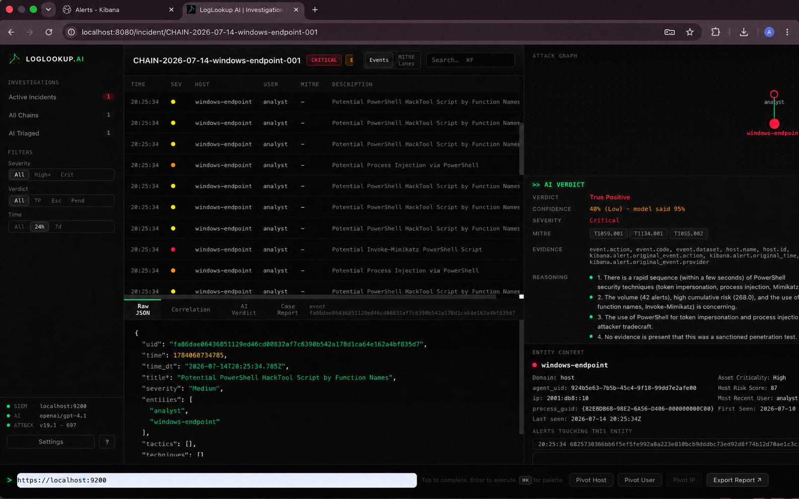
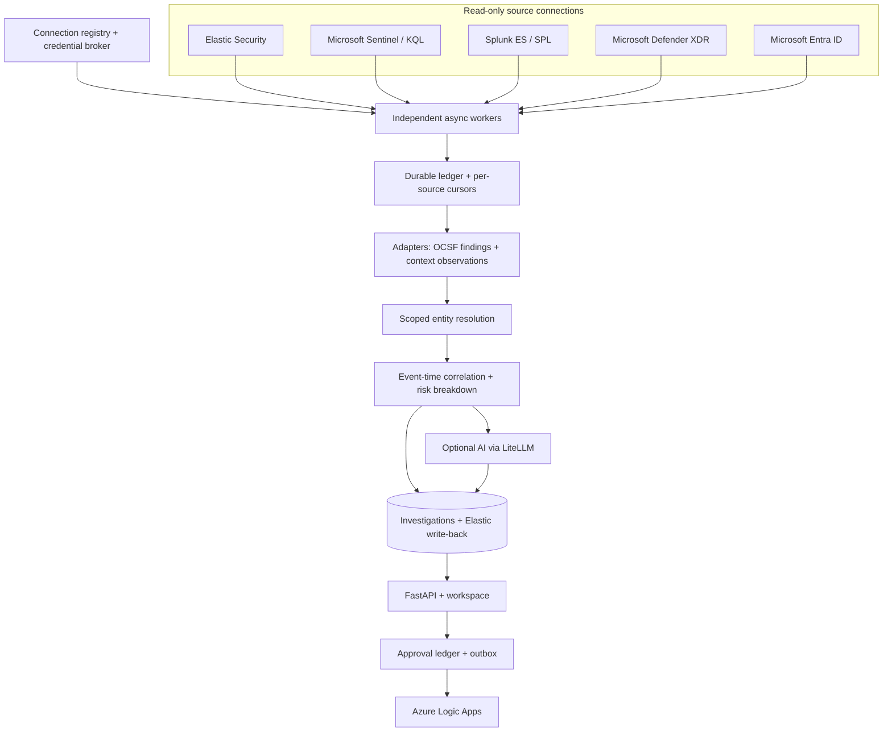
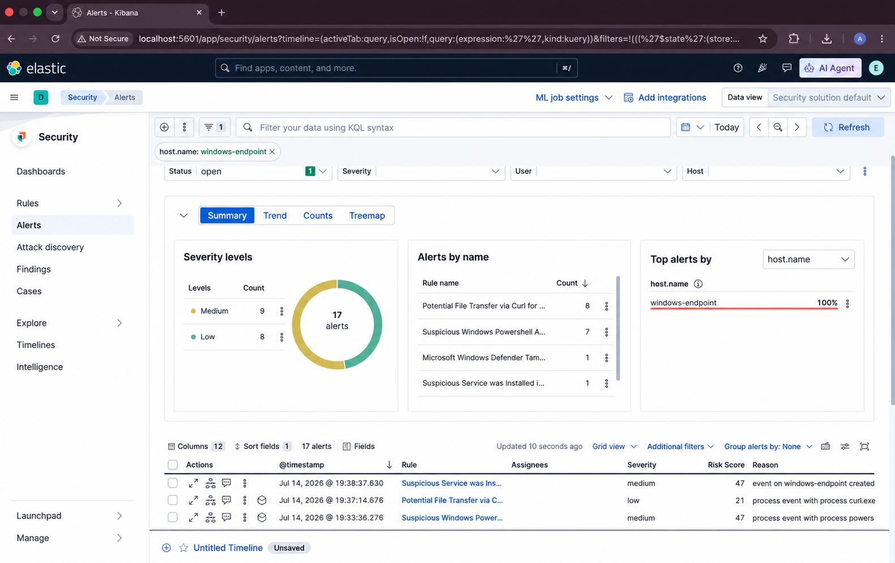
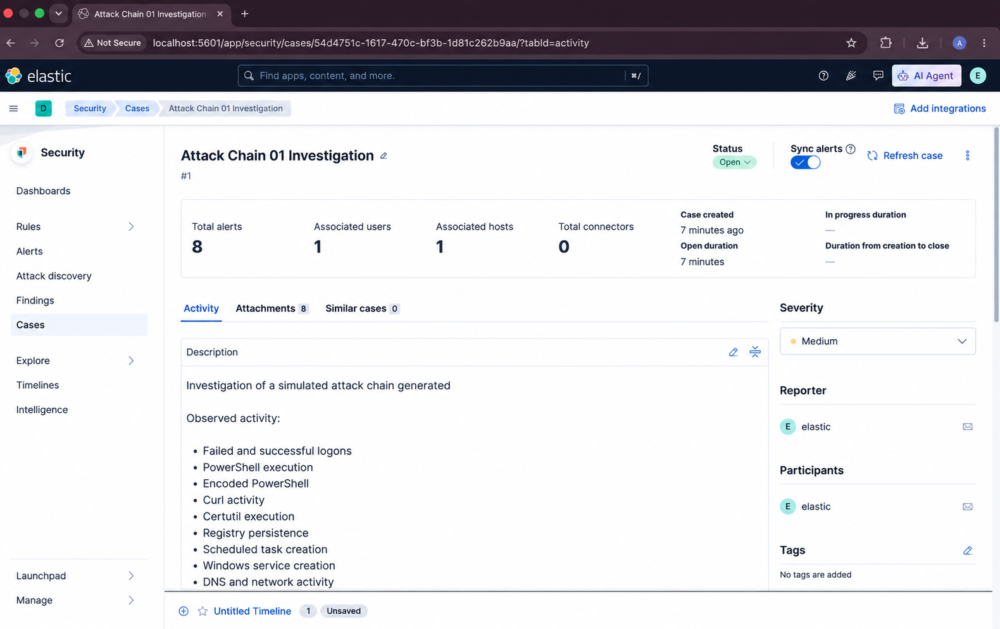

<div align="center">

# LogLookup AI

**One investigation across your whole security stack.**
Elastic Security, Microsoft Sentinel, Splunk, Defender XDR and Entra ID in. Evidence-grounded attack chains out. Approved response through Azure Logic Apps.

[](#release-v200)
[](#installation)
[](https://schema.ocsf.io/)
[](LICENSE)
[](https://github.com/RabbitEyesec/LogLookup.AI/actions/workflows/tests.yml)

</div>



*Investigation workspace: event stream, attack graph, AI verdict, raw evidence and entity context in one view.*

---

## About

LogLookup AI is a cross-platform investigation engine for security operations. It reads alerts and identity context from the tools you already run, normalizes detections to **OCSF**, and groups related activity into deterministic attack chains **before any AI is involved**. Chains that span platforms - a Sentinel execution alert, a Defender credential-access alert, an Entra sign-in from a new IP - become one investigation with a transparent risk breakdown, a MITRE ATT&CK timeline, and a grounded AI assessment that can cite only the evidence it was given.

**Version 2.0.0** turns the Elastic-only pipeline into a multi-source platform:

- five read-only source connectors, each an independently supervised, individually paused, individually credentialed connection;
- a durable evidence ledger with source cursors, deduplication, revisions and encrypted raw payloads;
- cross-source correlation with explainable, duplicate-aware risk;
- an approval-gated response channel into Azure Logic Apps with idempotent delivery and reconciliation;
- an updated workspace with a connections panel, source badges, an evidence inspector and a response drawer.

Every existing contract is preserved: OCSF Detection Findings, `CHAIN-YYYY-MM-DD-<entity>-NNN` ids, Elasticsearch result documents and `/incident/<cluster_id>` deep links.

## Supported Integrations

<table>
  <tr>
    <td align="center" width="170"><br><b>Elastic Security</b><br><sub>Alerts, write-back</sub></td>
    <td align="center" width="170"><br><b>Microsoft Sentinel</b><br><sub>KQL via Azure Monitor Logs</sub></td>
    <td align="center" width="170"><br><b>Splunk Enterprise / ES</b><br><sub>SPL via REST search</sub></td>
    <td align="center" width="170"><br><sub>Graph Security alerts &amp; incidents</sub></td>
    <td align="center" width="170"><br><b>Microsoft Entra ID</b><br><sub>Sign-in &amp; directory audit context</sub></td>
  </tr>
  <tr>
    <td align="center"><br><b>Azure Logic Apps</b><br><sub>Approved response workflows</sub></td>
    <td align="center"><br><b>Kibana</b><br><sub>Cases &amp; result deep links</sub></td>
    <td align="center"></td>
    <td align="center"></td>
    <td align="center"></td>
  </tr>
  <tr>
    <td align="center"><br><b>Ollama</b><br><sub>Local models</sub></td>
    <td align="center"><br><b>Anthropic</b><br><sub>Cloud AI</sub></td>
    <td align="center"><br><b>OpenAI</b><br><sub>Cloud AI</sub></td>
    <td align="center"><br><b>FastAPI</b><br><sub>API &amp; workspace server</sub></td>
    <td align="center"><br><b>SQLite (WAL)</b><br><sub>Durable operational store</sub></td>
  </tr>
</table>

| Integration | Role | Direction | Evidence handled |
|---|---|---|---|
| Elastic Security | Alert source, results store | Read + write-back | Detection alerts |
| Microsoft Sentinel | Alert source (KQL) | Read-only | `SecurityAlert` rows, entities, tactics, techniques |
| Splunk Enterprise / ES | Alert source (SPL) | Read-only | Notables and allowlisted-index events |
| Microsoft Defender XDR | Alert + incident source | Read-only | `alerts_v2`, incidents, device/user/process evidence |
| Microsoft Entra ID | Identity context | Read-only | Sign-ins, directory audits (never counted as detections) |
| Azure Logic Apps | Response channel | Outbound, approval-gated | Allowlisted workflows |
| MITRE ATT&CK | Technique grounding | Local knowledge base | Retrieval candidates for AI |
| OCSF 1.1 | Normalization schema | - | Detection Finding (`class_uid` 2004) |
| Ollama / Anthropic / OpenAI | Optional AI triage | Via LiteLLM | Redacted, bounded evidence |

<sub>Product names and logos belong to their respective owners and are used to identify supported integrations. Microsoft Azure icons are the unmodified official architecture icons.</sub>

## Release v2.0.0

**Multi-source investigations**

- **Connectors** for Elastic Security, Microsoft Sentinel (versioned KQL templates), Splunk Enterprise / ES (snapshot search jobs on `_indextime`), Microsoft Defender XDR (Graph Security alerts and incidents) and Microsoft Entra ID (sign-ins, directory audits).
- **Connection registry**: any number of workspaces, clusters and tenants, each with its own scope, cursor, health state and encrypted credential. Add, pause, resume and rotate credentials from the UI without a restart.
- **Honest source states**: healthy, paused, not configured, permission denied, limited by licence, throttled, temporarily unavailable - each visually distinct.

**Evidence and correlation**

- **Durable ledger** (SQLite WAL): atomic page-and-cursor commits, deterministic scope-bound canonical ids, revisions for changed alerts, alias-based duplicate suppression (a Sentinel alert that also arrives through Graph counts once), AES-256-GCM encrypted raw payloads with verified content hashes, bounded retention.
- **Cross-source chains** with provenance on every alert, and four-component risk: severity evidence, independent source confirmation, attack progression, benign or conflicting context.
- **Identity context**: Entra sign-ins and directory changes joined strictly through scope-bound UPNs, shown beside the chain and never inflating alert counts.
- **Stable ids**: chains are anchored, so `/incident/<cluster_id>` links survive restarts and merges.

**AI**

- Source-aware bounded evidence with citable references (`SRC:<connection>:<kind>:<id>`), a per-source evidence budget so one noisy source cannot crowd out the others, and validator checks that flag any reference the model was never given.
- Source text is declared untrusted data in the system prompt. Deterministic results stay available with no AI provider.
- Reports gain source coverage, risk rationale, evidence appendix, identity context and response history.

**Response**

- Allowlisted Azure Logic Apps workflows with typed payloads, role-based proposal and approval, separation of duties, expiry, an idempotency key, and a hash-chained audit trail.
- Ambiguous deliveries move to `reconciliation_required` and are never resent automatically. Workflow acceptance, run reference and downstream effect are reported as three separate statuses.

**Platform**

- `/api/v2` for connections, investigations, evidence, timeline, graph, links, notes, assignment, actions, audit and metrics, with server-side roles (`viewer`, `analyst`, `responder`, `administrator`), revision checks and write-only credentials.
- Hardened systemd unit, `loglookup token` and `loglookup snapshot` commands, versioned schema migrations.
- Backward compatible: the existing single-Elastic configuration keeps working and appears as the `elastic-default` connection.

**v2.0.1 - reliability patch**

- Lossless Sentinel paging on a total `(TimeGenerated, SystemAlertId)` order, and Splunk snapshot search jobs paged by `sid` + `offset`; truncated, partial or unkeyed provider results stop the page instead of being skipped.
- A durable ledger-to-correlation queue: acquired detections can no longer be lost between the cursor commit and the correlator, and restarts drain the backlog without double counting.
- Atomic response settlement and crash recovery that repairs the outbox without ever resending an ambiguous action.
- Truthful health: committed-watermark lag, per-stream progress, `degraded` and `backlogged` states, correlation queue depth, and a bounded, audited administrator backfill.

**Next - revisions and remote status** (unreleased)

- Updated vendor alerts re-score their chain in place: same alert count, recomputed risk and ATT&CK progression, a new investigation revision only on a material change, review flags when a change can't be applied deterministically, stale AI analyses marked, and pending response proposals re-checked.
- A read-only Azure Logic Apps run-status lookup (Consumption and Standard) with a **Check remote status** action: exact matching, Azure's status kept apart from LogLookup's state and from the downstream effect.
- Operating decisions made explicit: fail-closed bad rows with administrator recovery, a blocking (not silent) cursor reset when query settings change, and a visible Splunk event-time floor.

Full notes: [CHANGELOG.md](CHANGELOG.md) - upgrade steps: [docs/v2/migration.md](docs/v2/migration.md).

## Architecture



| Layer | What it guarantees |
|---|---|
| Acquisition | At-least-once with overlap; one failing source never stops the others |
| Ledger | Exactly-once-per-revision effect; cursor never ahead of durable data |
| Correlation | Deterministic, event-time ordered, scope-bound; weak identifiers never merge across tenants |
| AI | Runs after the chain exists; cites only supplied evidence |
| Response | Approved, idempotent, auditable; ambiguity is reconciled, not retried |



*Elastic Security alerts for one endpoint before LogLookup AI groups them into an investigation.*

## Key Capabilities

- Elastic Security, Sentinel, Splunk, Defender XDR and Entra ID ingestion with per-source cursors and health
- OCSF Detection Finding (`class_uid` 2004) normalization with vendor severity preserved
- Deterministic pre-filtering, scoped entity resolution, event-time attack-chain correlation, explainable risk
- MITRE ATT&CK retrieval (lexical or embedding-based) and post-generation grounding of techniques, fields and evidence references
- Local Ollama, Anthropic and OpenAI providers through LiteLLM, with redaction before any cloud call
- Investigation workspace: timeline, 2D/3D graph, raw evidence, source badges, evidence inspector, response drawer
- Elastic result write-back and Kibana deep links, idempotent by `cluster_id`
- Approval-gated Azure Logic Apps response with reconciliation and a tamper-evident audit trail

## Installation

LogLookup AI supports Linux with Python 3.11, 3.12 or 3.13 (macOS works for development). From a source checkout:

```bash
bash deploy/install.sh
loglookup open
```

The per-user installer creates an isolated environment, installs the launcher and desktop entry, configures a hardened systemd user service when available, and builds the MITRE ATT&CK knowledge base. Use `--skip-kb` or `--skip-service` when those steps do not apply.

## Quick Start for Development

```bash
python3 -m venv .venv
.venv/bin/pip install -e '.[dev]'
cp config.example.yaml config.yaml

export LOGLOOKUP_SIEM_KEY='YOUR_API_KEY'      # single-Elastic mode
export LOGLOOKUP_AI_KEY='YOUR_AI_API_KEY'     # only for a cloud AI provider

.venv/bin/python -m engine.ai.kb --build      # official MITRE ATT&CK STIX bundle

# Dashboard against the included fixture
.venv/bin/python -m engine.server --config config.yaml --input tests/fixtures/attack_chain.ndjson
```

Open `http://localhost:8080`. For a UI-only preview, run `python3 preview_ui.py` and open `http://127.0.0.1:4173/?preview=1`.

Continuous Elastic polling with AI triage and write-back:

```bash
.venv/bin/python -m engine.server --config config.yaml --mode poll --writeback
```

## Connecting Sources

Open **Sources** in the workspace, choose **Add a connection**, enter non-secret options and the credential, then enable it. Or declare sources in `config.yaml` (see [`config.example.yaml`](config.example.yaml)); every source starts disabled.

| Source | Grant needed | Notes |
|---|---|---|
| Elastic Security | API key, read on the alert index | The original `siem:` block appears as `elastic-default` |
| Microsoft Sentinel | Log Analytics Reader on the workspace | Azure Monitor Logs token; separate from any Graph grant |
| Splunk | Token that can search the allowlisted indexes | HTTPS management port; private CA supported |
| Defender XDR | Graph `SecurityAlert.Read.All`, `SecurityIncident.Read.All` | Admin consent |
| Entra ID | Graph `AuditLog.Read.All` | Sign-in logs need Entra ID P1/P2 |

Credentials are stored AES-256-GCM encrypted with owner-only permissions, accepted write-only, and never returned by the API. Details: [docs/v2/provider-configuration.md](docs/v2/provider-configuration.md).

## Analyst Workflow

1. Complete onboarding and connect one or more sources.
2. Choose a local or cloud AI provider (optional - deterministic results stand alone).
3. Let the workers collect; chains form across platforms and surface when risk crosses the threshold.
4. Open an incident: timeline, graph, entities, identity context, source evidence and AI verdict side by side.
5. Propose a response workflow, review the exact outbound payload, and have a responder approve it.
6. Continue in Kibana, Sentinel, Splunk or Defender through the linked results and provider URLs.



*An attack-chain case in Elastic after the investigation workflow.*

## HTTP API

Existing routes are unchanged. New in v2 (all under `/api/v2`):

| Area | Routes |
|---|---|
| Connections | `GET/POST /connections`, `GET/PATCH /connections/{id}`, `POST /connections/{id}/pause`, `/resume`, `POST/GET /connections/{id}/backfill`, `POST /connections/{id}/retry`, `/skip-bad-rows`, `/cursor/confirm`, `GET /sources/health` |
| Investigations | `GET /investigations`, `/investigations/{id}`, `/evidence`, `/evidence/{event}/revisions/{n}`, `/revisions`, `/review-flags`, `/timeline`, `/graph`, `/external-links`, `/actions` |
| Analyst records | `POST /investigations/{id}/notes`, `/assign` |
| Response | `GET /response/workflows`, `POST /investigations/{id}/actions`, `POST /actions/{id}/approve`, `/reject`, `/cancel`, `/reconcile`, `/check-status`, `GET /actions/{id}` |
| Operations | `GET /audit`, `/audit/verify`, `/metrics` |

Mutations carry the investigation revision they acted on (`409` when stale), roles are enforced server-side (`403`), and dependent-service outages return `503`. Interactive docs at `/api/docs`.

## Security Model

- **Identity**: role-bound API tokens, trusted reverse-proxy identity from listed peers only, and a loopback-only local owner protected against cross-site requests.
- **Data**: raw evidence AES-256-GCM encrypted at rest with hash verification, secrets in the encrypted store, owner-only files, bounded retention.
- **Network**: HTTPS and host allowlists for connectors, metadata and link-local targets refused, server-supplied pagination links pinned to the provider host.
- **Queries**: KQL and SPL come from reviewed templates with typed parameters; index and table names are allowlisted.
- **AI**: redaction before cloud calls, zero-data-retention acknowledgement, grounded output, source text treated as untrusted.
- **Response**: no action without approval; separation of duties; hash-chained audit; no containment workflow shipped by default.

See [docs/v2/security-and-operations.md](docs/v2/security-and-operations.md).

## Documentation

For the complete implementation from lab deployment and Elastic configuration through endpoint telemetry, detection validation and the end-to-end investigation, read the [Project Execution Report](docs/LogLookup-AI-Project-Execution-Report.pdf).

- [Product overview](docs/product.md)
- [Architecture](docs/architecture.md)
- [Developer guide](docs/Developerguide.md)
- [User guide](docs/User%20guide.md)
- v2: [source contracts](docs/v2/source-contracts.md) - [provider configuration](docs/v2/provider-configuration.md) - [security and operations](docs/v2/security-and-operations.md) - [Logic Apps contract](docs/v2/logic-apps-contract.md) - [migration](docs/v2/migration.md)
- [Example configuration](config.example.yaml)

## Development and Validation

```bash
.venv/bin/python -m pytest
```

The suite covers configuration, ingestion, normalization, correlation, entity resolution, risk, AI grounding, redaction, reporting, write-back, the managed API and setup, and for v2: connector transports (retry, throttling, SSRF guards, query building), the durable ledger, end-to-end multi-source correlation over mocked vendor APIs, restart stability, the response state machine (approval, idempotency, crash recovery, reconciliation), and the API security boundary (identity, roles, revisions, write-only secrets).

## Roadmap

The connector contract is the extension point for further sources - AWS CloudTrail, Amazon GuardDuty, CrowdStrike Falcon and Nessus / Qualys vulnerability context follow the same registry, ledger and adapter path. Microsoft Sentinel incident synchronisation and Defender Advanced Hunting enrichment are planned as separately permissioned capabilities.

## License

Apache License 2.0 - see [LICENSE](LICENSE).
